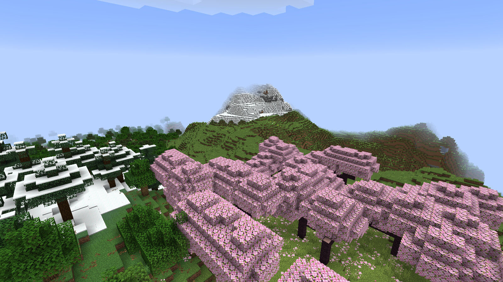
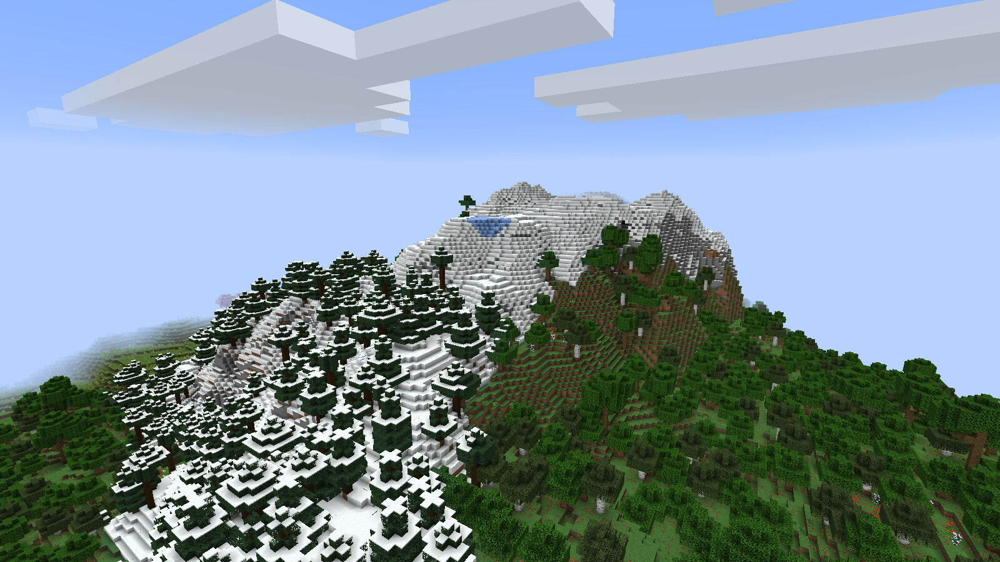
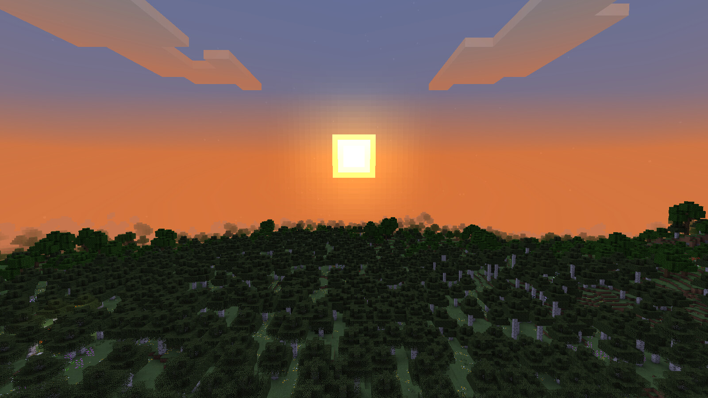
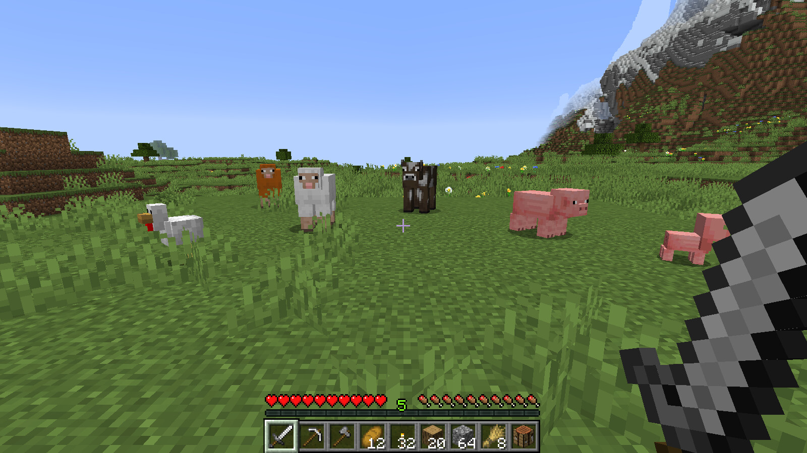
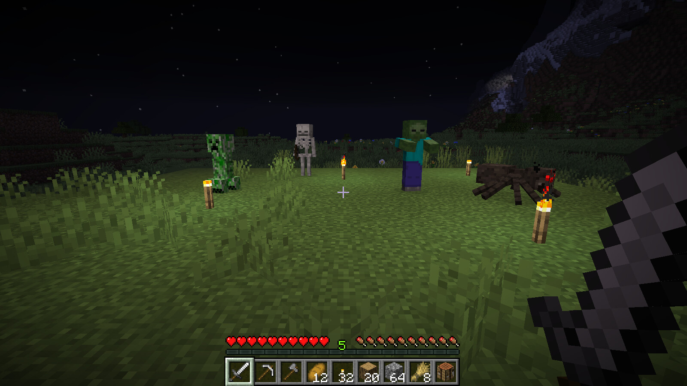
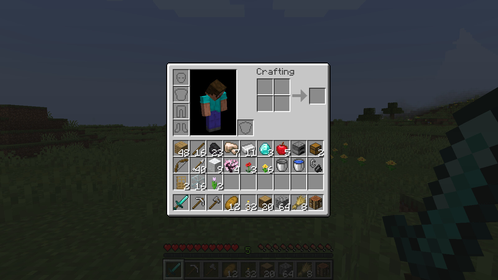

# minecraft-cpp

A single-player Minecraft (Java Edition) style game written from scratch in C++20 and OpenGL 4.5.

- **World:** an infinite 1.18-style overworld with caves, aquifers, ores, trees and 51 biomes.
- **Survival:** health and hunger, tools, armor, crafting (about 1,000 recipes), furnaces and chests.
- **Mobs:** 8 mobs with pathfinding, combat and breeding.
- **Simulation:** flowing water and lava, fire, TNT, crops, and day, night and weather.
- **Menus:** vanilla's menus, inventories and HUD.

It runs at about 1,800 FPS at render distance 16 and 1080p on an RTX 3070.

| | |
|---|---|
|  |  |
|  |  |
|  |  |

## Textures
The game loads its visuals at runtime from the vanilla Java 1.21.7–1.21.8 resource pack: models, textures, fonts, GUI sprites and language strings. **The pack is not included**: those assets belong to Mojang. Supply your own copy, for example extracted from a Minecraft jar you own. Either:
- put the folder that contains `assets/` next to the code as `Java Default Textures 1.21.7 - 1.21.8/`, or
- pass `--assets <folder>`.

Gameplay data (recipes, loot, world generation) is hand-written in `data/`. There is no sound.

## Build and run
You need CMake ≥ 3.20, Ninja, GCC ≥ 13 or Clang ≥ 17, and glfw, glm, nlohmann-json, libpng, zstd and gtest. On Arch:
```sh
sudo pacman -S cmake ninja glfw glm nlohmann-json libpng zstd gtest
cmake --preset release && cmake --build --preset release
./build/release/bin/minecraft
```

Controls:
- WASD and the mouse to move and look; Space to jump; Shift to sneak; Ctrl to sprint
- Left click to break and attack; right click to place and use
- E: inventory; Esc: pause menu; T: chat and commands
- F1: hide the GUI; F2: screenshot; F3: debug screen; F5: third person

## More
- [docs/GUIDE.md](docs/GUIDE.md): every option, control and command, the test harness and the source layout
- [docs/STATUS.md](docs/STATUS.md): milestones, differences from vanilla, and what is left out (redstone logic, the Nether and the End, structures, villagers, enchanting)
- [docs/DESIGN.md](docs/DESIGN.md): formulas and engine conventions

Not an official Minecraft product. Not approved by or associated with Mojang or Microsoft.
