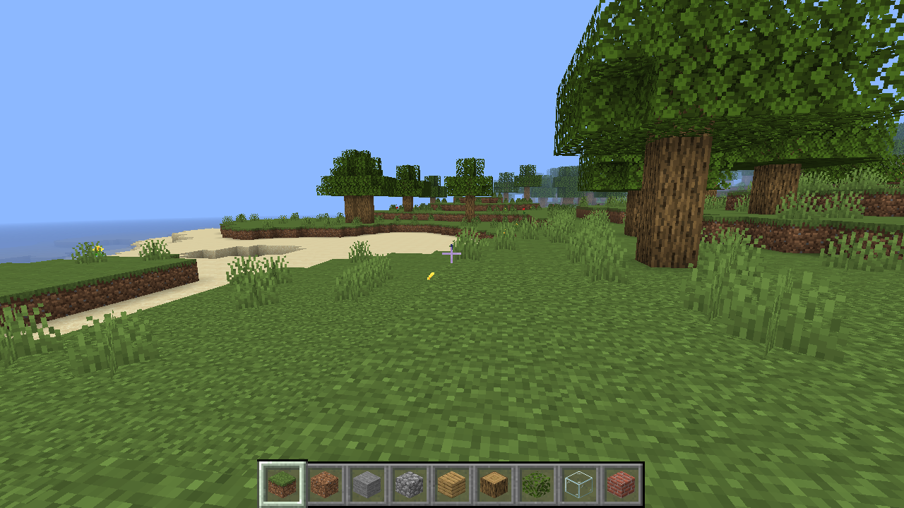
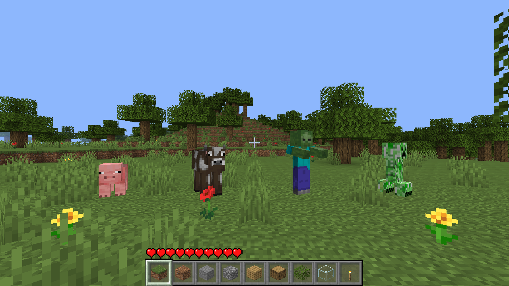
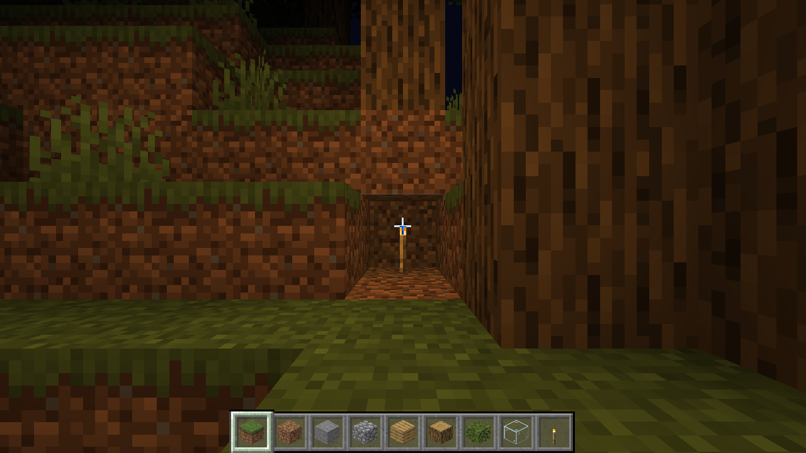
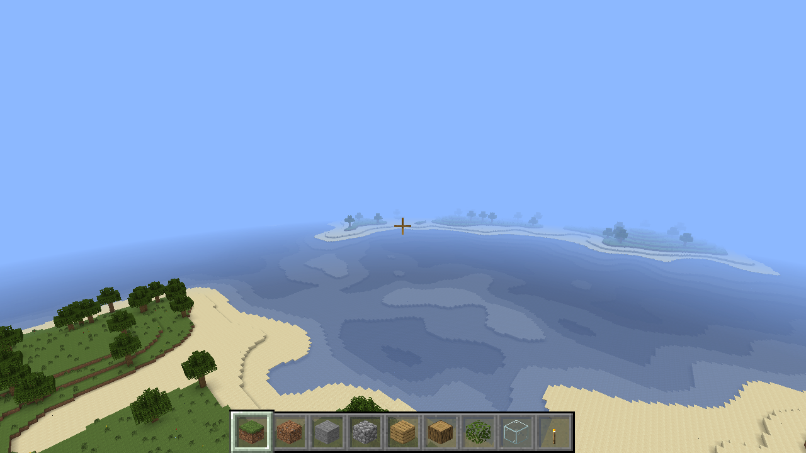

# Minecraft C++

A Minecraft clone written from scratch in C++17 / OpenGL 3.3, rendering with the
official Java Edition 1.21.8 textures loaded from a vanilla resource pack at
runtime.

The resource pack is **not** included in this repository — those assets belong to
Mojang. See [Textures](#textures) below.






## Features

- Infinite procedurally generated world (chunked 16×128×16, streamed around the player)
  - Continents, rolling hills, snow-capped mountains with bare stone cliffs
  - Oceans, beaches, forests, flowers and tall grass
  - Cave systems (spaghetti + blob carving) with coal / iron / diamond ore
  - Oak trees that generate correctly across chunk borders
- Lighting (Minecraft-style voxel light engine)
  - Per-block sky light + block light (0–15) with BFS propagation across chunks
  - Water and leaves attenuate light; caves are genuinely dark
  - Placeable torches (slot 9) with warm light and correct incremental
    addition/removal when blocks change
  - Smooth (per-vertex averaged) lighting combined with ambient occlusion
- Day/night cycle (10 min): moving sun and moon, dawn/dusk sky colors,
  darkening clouds, in-game clock in the title bar, T to fast-forward
- Mobs (real box models + skins from the resource pack)
  - Pigs and cows wander the grasslands and flee when hit
  - Zombies spawn in darkness (night surface + caves), chase and attack you,
    and burn up in morning sunlight
  - Creepers stalk you, hiss-flash, and explode — destroying terrain
  - Walk/chase animations, look-at-player heads, hurt flash, death roll
  - Player health with vanilla hearts HUD, knockback, damage vignette,
    regeneration, respawn at spawn point (flying = creative: invulnerable)
- Renderer
  - Texture-array atlas built at runtime from the resource pack (biome tints baked in)
  - Greedy meshing: coplanar faces with identical light merge into large quads
    (UVs derived from world coordinates + repeat sampling), including the ocean surface
  - Animated water (the real 32-frame `water_still` strip) with translucent sorted pass
  - Distance fog, drifting clouds (`clouds.png`), underwater fog + overlay
  - Frustum culling; meshes and light rebuilt incrementally on edits
- Gameplay
  - Walking, sprinting, jumping, swimming, flying; AABB collision
  - Break / place / pick blocks with raycast targeting and a selection outline
  - Vanilla-style HUD: hotbar + selection sprites, isometric block icons, inverting crosshair
- Screenshots (F2) saved as PNG

## Textures

The renderer builds its atlas from a vanilla Java Edition resource pack, which is
not distributed here. To run the game, extract the textures from a copy of
Minecraft you own (or any 1.21.7–1.21.8 resource pack) so that you have an
`assets/minecraft/textures/` tree, and either:

- place it in this directory as `Java Default Textures 1.21.7 - 1.21.8/`, or
- pass `--assets <path-to-resource-pack>/assets/minecraft/textures`.

UV layouts are tuned for the 1.21.7–1.21.8 mob and block textures; older packs
may render incorrectly.

## Building (Linux)

Dependencies: `cmake`, a C++17 compiler, `glfw`, `glew`, `glm`, `libpng`.

```sh
cmake -B build -DCMAKE_BUILD_TYPE=Release
cmake --build build -j
./build/minecraft
```

Run from this directory so the game can find the texture pack (or pass
`--assets <path-to-textures-dir>`).

## Controls

| Input | Action |
| --- | --- |
| WASD + mouse | Move / look |
| Space | Jump / swim / fly up |
| Left Shift | Fly down |
| Left Ctrl | Sprint |
| F | Toggle flying |
| T | Fast-forward time (hold) |
| Left click | Break block / punch mob |
| Right / Middle click | Place / pick block |
| 1–9, scroll wheel | Select hotbar slot (9 = torch) |
| F2 | Screenshot |
| Esc | Release mouse (click to recapture) |

## Options

| Flag | Meaning |
| --- | --- |
| `--seed <n>` | World seed (default: random) |
| `--view <r>` | View distance in chunks (default 10, up to 32) |
| `--timeofday <t>` | Starting time: 0 sunrise, 0.25 noon, 0.5 sunset, 0.75 midnight |
| `--assets <dir>` | Path to the resource pack `textures` directory |

There are also a few flags used for automated testing: `--frames`, `--shot`,
`--tp x,y,z`, `--look yaw,pitch`, `--fly`, `--findpeak`, `--poke`, `--mobtest`
(spawns a frozen one-of-each lineup) and `--mobyaw <deg>` (lineup facing:
90 = toward the camera, 0 = profile).

## Code layout

| File | Purpose |
| --- | --- |
| `src/main.cpp` | Window, game loop, input, chunk streaming, day/night, rendering, HUD |
| `src/world.*` | Chunk storage, terrain/cave/tree generation, light propagation, raycast |
| `src/mesher.*` | Greedy chunk meshing: face culling, vertex AO, smooth light, water/plants |
| `src/player.*` | Physics: movement, gravity, swimming, AABB collision, health |
| `src/mobs.*` | Mob models/animation/rendering, AI, spawning, combat, explosions |
| `src/blocks.*` | Block registry and texture wiring |
| `src/texture.*` | PNG loading (libpng), texture-array atlas, animations |
| `src/noise.h` | Hash-based value noise / fBm |
| `src/shader.h`, `src/frustum.h` | GL shader helper, frustum culling |
